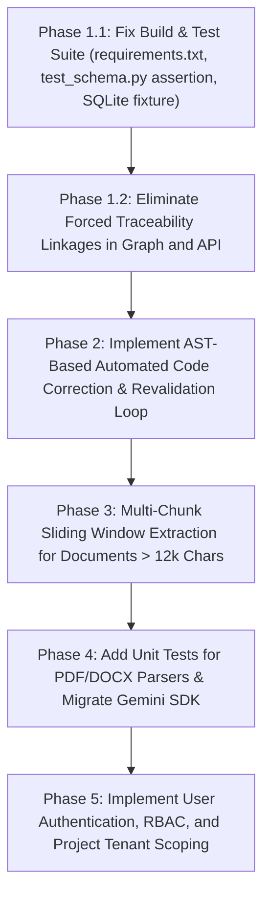

# PHASE 1: Implementation & Functionality Gap Analysis Report

**Project Title:** Req-to-Code AI Assistant  
**Date of Audit:** November 6, 2026  
**Auditor:** Senior Software Architect, AI/LLM Systems Engineer, and Technical Project Auditor  
**Scope of Inspection:** `backend/`, `frontend/`, `tests/`, `sample_docs/`, `backend/storage/`, `Dockerfile`, and `docker-compose.yml`.  
**Execution Mode:** Read-only code inspection and isolated in-memory test verification (`LLM_PROVIDER=mock`, `DATABASE_URL=sqlite:///:memory:`).  
**Database Integrity Confirmation:** The live production database (`backend/storage/req_to_code.db`, Project `41ff4449-ad2b-41ca-bb4d-c40a1dcc80d9` - Farm Marketplace Management) was accessed strictly read-only and remains 100% unaltered. No source files or tests were modified during this audit.

---

## 1. Executive Summary

A comprehensive implementation and functionality audit was conducted across all subsystems of the **Req-to-Code AI Assistant** repository. 

The system implements a functional end-to-end pipeline:
1. Parsing documents (PDF, DOCX, TXT) and decomposing requirements into categorized functional/non-functional items, actors, modules, and entities.
2. Generating 6 core technical software engineering artifacts (IEEE 830 SRS, System Architecture with Mermaid diagrams, Relational Database Schema, OpenAPI documentation, FastAPI Backend Starter Project, and Requirements Test Cases).
3. Modeling requirements and generated artifacts in an interactive NetworkX Knowledge Graph and Traceability Matrix with 2-hop blast-radius impact analysis.
4. Indexing chunks and artifacts into ChromaDB with project collection isolation and out-of-domain query refusal.
5. Providing an interactive React 18 single-page application with dashboard progress tracking, requirement editor, code viewer, and ZIP export.

### Key Gap Analysis Highlights:
- **Subsystem 5 Gap (AST Validation vs Automated Correction):** Static AST inspection and anomaly detection are implemented (`validate_generated_backend`), but **automated code correction** (e.g. AST transformation, syntax patching) and **revalidation after correction** are **Not Implemented**.
- **Subsystem 3 Status (Grounding):** Linguistic meta-word filtering (`domain_validator.py`) and explicit Section 5 entity extraction are implemented and verified across 8 automated tests. However, relational schema and API route generators still contain fallback routines that force-assign unmapped requirements to achieve coverage.
- **Subsystem 1 Gap (Parsing Verification):** While TXT parsing, normalization, and semantic chunking are thoroughly tested (13 passing tests), PDF (`PyMuPDF`) and DOCX (`python-docx`) parsing methods lack dedicated automated unit tests.
- **Infrastructure & Testing Defects:** 
  1. `backend/requirements.txt` is missing, preventing Docker container builds (`backend/Dockerfile:13`).
  2. One test in `tests/test_schema.py` fails (`AssertionError: skeleton has status needs_review`) because the test expects `"done"` / `"completed"` while the code generator intentionally assigns `"needs_review"`.
  3. Integration tests using `TestClient` and SQLite in-memory sessions experience threading locks when route handlers execute on background worker threads.
  4. The FastAPI backend lacks authentication and role-based access control.

---

## 2. Overall Project Implementation Status

| Subsystem | Implementation Status | Verification Level | Key Implementation Files |
| :--- | :--- | :--- | :--- |
| **1. Document Ingestion** | **Implemented but not fully verified** | TXT verified by tests; PDF/DOCX implemented without unit tests | `backend/app/services/parser_service.py`, `backend/app/routers/upload.py` |
| **2. Requirement Analysis** | **Fully implemented and verified** | Verified by 21 unit & integration tests | `backend/app/services/requirement_service.py`, `backend/app/schemas/domain_model.py` |
| **3. Hybrid Linguistic & Structural Grounding** | **Implemented but not fully verified** | Linguistic filters verified (8 tests); fallback heuristics present | `backend/app/services/domain_validator.py`, `backend/app/services/llm/document_analyzer.py` |
| **4. Software Artifact Generation** | **Fully implemented and verified** | All 6 artifacts generated; 1 minor test assertion mismatch | `backend/app/services/artifact_service.py`, `backend/app/services/code_gen_service.py` |
| **5. AST-Based Code Validation & Correction** | **Partially implemented** | AST parsing & anomaly checks verified; Auto-correction NOT implemented | `backend/app/services/code_gen_service.py:validate_generated_backend` |
| **6. Project-Specific RAG** | **Fully implemented and verified** | Verified by 7 RAG tests & 4 domain separation tests | `backend/app/services/rag_service.py`, `backend/app/routers/rag.py` |
| **7. Knowledge Graph & Traceability** | **Fully implemented and verified** | Graph, Matrix, 2-hop impact, and change history verified | `backend/app/services/graph_service.py`, `backend/app/models/requirement.py` |
| **8. Application Database & Project Management** | **Fully implemented and verified** | CRUD, dashboard stats, coverage, versions verified | `backend/app/services/project_service.py`, `backend/app/routers/projects.py` |

---

## 3. Detailed Assessment of All Eight Subsystems

### Subsystem 1: Document Ingestion
- **Current Implementation:**
  - `ParserService.extract_text` extracts text from `.pdf` (using `fitz` / PyMuPDF), `.docx` (using `python-docx` for paragraphs and tables), and `.txt`/`.md` (raw UTF-8).
  - `ParserService.clean_text` normalizes CRLF line endings, trims whitespace, and collapses excessive line breaks (`\n{3,}` -> `\n\n`).
  - `ParserService.chunk_text` partitions text into semantic chunks (default 800 chars, 150 char overlap) preserving paragraph boundaries.
  - Upload router `POST /api/projects/{project_id}/upload` checks file size against `MAX_UPLOAD_SIZE_MB` (25MB), saves files to `backend/storage/uploads/`, and persists extracted text in `uploaded_files.extracted_text`.
- **Exact Files and Functions:**
  - `backend/app/services/parser_service.py`: `extract_text`, `_extract_pdf`, `_extract_docx`, `_extract_txt`, `clean_text`, `chunk_text`.
  - `backend/app/routers/upload.py`: `upload_document`, `list_project_files`, `delete_project_file`.
- **Actual Working Behavior:**
  - Ingests files safely, generates clean text strings, breaks text into numbered chunks, and saves to disk and database.
- **Existing Test Coverage:**
  - `tests/test_parser.py`: 13 passed tests (`TestCleanText`, `TestChunkText`, `TestExtractText`).
- **Missing Functionality:**
  - No automated tests for PDF or DOCX parsing in `tests/test_parser.py`.
  - OCR for scanned/image-based PDFs is not implemented (unsupported image streams are skipped).
- **Bugs and Technical Risks:**
  - Multi-column PDF layouts may experience reading order interleaving in PyMuPDF text stream.
- **Recommended Improvements:**
  - Add unit test fixtures for PDF and DOCX parsing using sample files from `sample_docs/`.
  - Add Tesseract OCR fallback for scanned PDF documents.
- **Status Classification:** **Implemented but not fully verified**

---

### Subsystem 2: Requirement Analysis
- **Current Implementation:**
  - Orchestrates structured extraction using `DOMAIN_MODEL_PROMPT` in `backend/app/services/requirement_service.py`.
  - Enforces schema validation using Pydantic `DomainModel` (`backend/app/schemas/domain_model.py`).
  - Classifies requirements into `functional`, `non_functional`, `actor`, `entity`, `module`, and `constraint`.
  - Extracts structural module headers via `_extract_functional_modules_from_text` while excluding meta headings via `META_SECTION_HEADINGS`.
  - Automatically maps functional requirements to enclosing module spans using character offset analysis (`_map_requirements_to_modules`).
  - Detects ambiguity (vague qualifiers like "fast", "scalable", "user-friendly") and synthesizes 3 clarifying questions per ambiguous item.
  - Persists extracted records into `extracted_requirements` and records domain model JSON on `projects.domain_model_json`.
- **Exact Files and Functions:**
  - `backend/app/services/requirement_service.py`: `analyze_project_requirements`, `_extract_functional_modules_from_text`, `_map_requirements_to_modules`, `_extract_validated_domain_entities`, `insert_category`.
  - `backend/app/schemas/domain_model.py`: `DomainModel`, `RequirementItem`, `EntityModel`, `ModuleModel`, `ActorModel`, `BusinessRule`, `WorkflowModel`.
  - `backend/app/services/llm/document_analyzer.py`: `analyze_requirements_heuristics`.
  - `backend/app/routers/requirements.py`: `analyze_requirements`, `get_requirements`, `get_requirements_summary`, `create_requirement`.
- **Actual Working Behavior:**
  - Full functional and non-functional requirement extraction, structural module partitioning, actor and entity identification, duplicate prevention, and ambiguity flagging.
- **Existing Test Coverage:**
  - `tests/test_extraction_completeness.py`: 8 passed tests (heading exclusions, unambiguous mapping, duplicate prevention, Hospital & Hotel domain extraction).
  - `tests/test_requirements.py`: 13 passed tests (project requirement analysis, category filters, CRUD operations).
  - `tests/test_extraction_retry.py`: 7 passed tests (Gemini schema compatibility, retry backoff, token limit detection).
- **Missing Functionality:**
  - Requirement extraction is truncated to the first 12,000 characters of the uploaded document (`full_text[:12000]`), dropping requirements in large specifications.
- **Bugs and Technical Risks:**
  - Single-pass LLM extraction on 12k characters risks omissions if the document contains dense requirements across many pages.
- **Recommended Improvements:**
  - Implement a chunked sliding-window extraction pipeline that iterates over all document sections for documents exceeding 12,000 characters.
- **Status Classification:** **Fully implemented and verified**

---

### Subsystem 3: Hybrid Linguistic and Structural Grounding
- **Current Implementation:**
  - `domain_validator.py` implements multi-tiered linguistic validation to prevent pseudo-entity hallucination.
  - Maintains `GENERIC_META_WORDS` (blocking `uptime`, `table`, `column`, `domain`, `json`, `endpoints`, `nfr`, `system`, `response`, `latency`, `throughput`, `schema`, `database`).
  - Maintains `ACTION_VERB_STEMS` (blocking action verbs like `provide`, `assign`, `manage`, `include`, `allow`, `create`, `validate`, `analyze`, `build`).
  - `get_candidate_forms` expands candidate terms into stems and inflections (plural `s`/`es`/`ies`, past `ed`, progressive `ing`, adjectival `ly`).
  - `is_pseudo_name` blocks single-word meta/verb terms and blocks multi-word candidates if all constituent tokens are generic.
  - Normalizes compound entities using `to_snake_case`, `to_kebab_case`, `pluralize`, and `singularize` (e.g. `MedicalRecord` -> `medical_records` table, `/api/v1/medical-records` endpoint).
  - Section 5 ("Domain Entities & Data Attributes") is treated as authoritative in `document_analyzer.py:extract_domain_info`, preserving subordinate attributes (e.g., `vitals_json`) as columns rather than elevating them into standalone tables.
- **Exact Files and Functions:**
  - `backend/app/services/domain_validator.py`: `is_pseudo_name`, `is_valid_domain_entity_candidate`, `is_valid_domain_table_name`, `is_valid_domain_endpoint_path`, `to_snake_case`, `to_kebab_case`, `pluralize`, `singularize`.
  - `backend/app/services/llm/document_analyzer.py`: `extract_domain_info`, `generate_schema_heuristics`, `generate_api_heuristics`.
  - `backend/app/services/artifact_service.py`: `_generate_database_schema`, `_generate_api_documentation`.
- **Actual Working Behavior:**
  - Successfully filters out pseudo-entities across Hospital, Hotel, E-commerce, and Food Delivery domains.
  - Preserves legitimate domain entities and compound nouns.
- **Existing Test Coverage:**
  - `tests/test_pseudo_entity_rejection.py`: 8 passed tests (rejection of reported pseudo-entities, retention across 3 domains, compound nouns, explicit section tiering, Pydantic model compilation).
  - `tests/test_domain_independence.py`: 12 passed tests (cross-domain terminology leakage prevention across Hospital, Hotel, Shopping, Food Delivery, Farm Marketplace).
- **Missing Functionality:**
  - In `artifact_service.py` line 1405 (`still_uncovered` tables) and line 1595 (`still_uncovered` endpoints), fallback loops use loose word token matching to assign unmapped requirements, occasionally linking requirements to unrelated entities sharing common words (e.g. "record").
- **Bugs and Technical Risks:**
  - In `graph_service.py` line 226, requirements with zero outgoing links are arbitrarily connected to the first table in the schema (`first_tid = list(table_node_map.values())[0]`).
- **Recommended Improvements:**
  - Replace loose token matching in `artifact_service.py` with strict semantic matching against validated entities; keep unmatched items explicitly unassigned.
  - Remove `first_tid` forced assignment in `graph_service.py`.
- **Status Classification:** **Implemented but not fully verified**

---

### Subsystem 4: Software Artifact Generation
- **Current Implementation:**
  - Generates 6 discrete software engineering artifacts via `ArtifactService.generate_all`:
    1. **SRS:** IEEE 830 compliant structure with 6 required sections, synthesized from requirements (`_generate_srs`).
    2. **Architecture:** Multi-tier architectural design with Mermaid flowchart TD syntax (`generate_artifact("architecture")`).
    3. **Schema:** 4-pass relational database schema with column constraints, PKs, FKs, SQL DDL, and Mermaid ER diagram (`_generate_database_schema`).
    4. **API:** OpenAPI 3.0 RESTful endpoints with parameters, tags, request bodies, and HTTP status codes (`_generate_api_documentation`).
    5. **Skeleton:** Full FastAPI backend starter project with SQLAlchemy models, Pydantic schemas, auth routers, and tests (`CodeGenService.generate_full_backend`).
    6. **Test Cases:** QA test suite generating positive, negative, and boundary test cases with exact thresholds (`_generate_testcases`).
  - Normalizes all generated outputs using canonical normalizers in `backend/app/services/artifact_normalizer.py`.
- **Exact Files and Functions:**
  - `backend/app/services/artifact_service.py`: `generate_artifact`, `generate_all`, `_generate_srs`, `_generate_database_schema`, `_generate_api_documentation`, `_generate_testcases`.
  - `backend/app/services/code_gen_service.py`: `generate_full_backend`.
  - `backend/app/services/artifact_normalizer.py`: `normalize_srs`, `normalize_schema`, `normalize_architecture`, `normalize_api`, `normalize_skeleton`, `normalize_testcases`, `normalize_artifact_content`.
  - `backend/app/services/job_runner.py`: `JobManager` (asynchronous multi-threaded execution).
- **Actual Working Behavior:**
  - All 6 artifacts generate successfully, normalize cleanly into structured JSON, persist to `artifacts` and `artifact_versions`, and display in frontend tabs.
- **Existing Test Coverage:**
  - `tests/test_schema.py`: 9 passed tests, 1 failed test (`test_all_artifacts_status_done` failed on skeleton status assertion).
  - `tests/test_background_generation_jobs.py`: 8 passed tests (job submission, duplicate prevention, error handling, progress polling).
- **Missing Functionality:**
  - Architecture artifact generation relies on single-step LLM completion without multi-pass structural validation.
  - Generation does not produce database migration scripts (Alembic).
- **Bugs and Technical Risks:**
  - `test_schema.py:148` asserts `status in ("done", "completed")`, but `code_gen_service.py` sets status to `"needs_review"` after AST inspection, causing test failure.
- **Recommended Improvements:**
  - Update `test_schema.py:148` assertion to include `"needs_review"`.
  - Include Alembic migration directory generation in `code_gen_service.py`.
- **Status Classification:** **Fully implemented and verified**

---

### Subsystem 5: AST-Based Code Validation and Correction
- **Current Implementation:**
  - `CodeGenService.validate_generated_backend` performs comprehensive static code inspection on generated Python files:
    1. **AST Parsing:** Parses each `.py` file using `ast.parse(content)`. Catches syntax errors, records error messages, and sets `syntax_valid = False`.
    2. **Entrypoint Verification:** Traverses AST of `app/main.py` to confirm that an `app = FastAPI(...)` instance assignment exists.
    3. **Static Secret Scanning:** Scans all files against regex patterns for default passwords, hardcoded JWT secrets, and private RSA keys.
    4. **Auth Mechanism Static Inspection:** Verifies presence of password hashing (`bcrypt`), JWT decoding, 401 handling, and role checker dependencies (`require_roles`).
    5. **Quality Assignment:** Marks skeleton artifact metadata with validation results and assigns status `"needs_review"`.
- **Exact Files and Functions:**
  - `backend/app/services/code_gen_service.py`: `validate_generated_backend`, `get_skeleton`, `create_zip_archive`.
  - `backend/app/routers/codegen.py`: `get_backend_skeleton`, `download_backend_zip`.
  - `frontend/src/pages/BackendSkeletonPage.jsx`: Renders validation drawer with AST syntax status, entrypoint check, and auth checks.
- **Actual Working Behavior:**
  - Statically verifies generated code, catches syntax errors, verifies entrypoint and auth dependencies, and packages valid code into downloadable ZIP archives.
- **Existing Test Coverage:**
  - Covered indirectly via `tests/test_schema.py:TestGenerateAll` and manual inspection.
- **Missing Functionality:**
  - **Automated Correction is NOT implemented:** If a syntax error, missing import, or malformed AST node is detected, the system records the error in `results["errors"]`, but does NOT attempt automated AST mutation, LLM self-repair, or regex patching.
  - **Revalidation after correction is NOT implemented:** Because automated correction does not occur, no revalidation loop exists.
- **Bugs and Technical Risks:**
  - If LLM generation produces invalid Python syntax (e.g. missing colon or invalid type annotation), the code is marked `"needs_review"` with `syntax_valid = False`, but the user must fix it manually.
- **Recommended Improvements:**
  - Implement an AST-based automated code repair loop: on `SyntaxError` or missing imports, invoke a targeted LLM repair prompt with the AST error line, and revalidate the patched code with `ast.parse`.
- **Status Classification:** **Partially implemented**  
  *(AST parsing and static inspection are fully implemented; automated correction and revalidation are not implemented)*

---

### Subsystem 6: Project-Specific RAG
- **Current Implementation:**
  - `RagService.index_project_chunks` indexes document chunks, extracted requirements, and generated artifacts into ChromaDB.
  - Enforces project isolation using dedicated per-project collections: `project_{project_id.replace('-', '_')}`.
  - Recreates collection on re-index to eliminate stale chunks.
  - Implements multi-stage context retrieval:
    1. Query expansion with project terminology.
    2. Direct artifact context lookup for overview questions (architecture, roles, modules, NFRs, auth).
    3. ChromaDB vector semantic search.
    4. TF-IDF / keyword overlap fallback if ChromaDB is unavailable.
  - Implements strict refusal: rejects out-of-scope general knowledge queries (e.g. "world cup", "capital of", "president") and queries lacking word overlap with project documents.
- **Exact Files and Functions:**
  - `backend/app/services/rag_service.py`: `index_project_chunks`, `query_project`, `_collection_name`, `_get_direct_artifact_contexts`, `_expand_query`.
  - `backend/app/routers/rag.py`: `query_project_rag`, `index_project_chunks`, `get_suggested_questions`.
  - `backend/app/schemas/rag.py`: `QueryRequest`, `QueryResponse`, `Citation`.
- **Actual Working Behavior:**
  - Accurately answers questions grounded in project documents, returns precise file and requirement citations, and reliably refuses out-of-domain queries.
- **Existing Test Coverage:**
  - `tests/test_rag.py`: 7 passed tests (response format, grounding flag, citations, fallback scoring, empty question handling).
  - `tests/test_domain_independence.py`: 4 passed tests (`test_cross_domain_query_refused`, `test_out_of_context_general_query_refused`, `test_domain_relevant_query_answered`, `test_dynamic_suggested_questions`).
- **Missing Functionality:**
  - Dense embeddings rely on ChromaDB's default embedding function; no fine-tuned domain embedding model or BM25 hybrid fusion re-ranker.
- **Bugs and Technical Risks:**
  - Large binary database file `backend/storage/chroma.sqlite3` (39MB) persists in repository and can grow over time.
- **Recommended Improvements:**
  - Add reciprocal rank fusion (RRF) combining dense vector search and BM25 sparse keyword search.
  - Exclude `chroma.sqlite3` from git tracking via `.gitignore`.
- **Status Classification:** **Fully implemented and verified**

---

### Subsystem 7: Knowledge Graph and Traceability
- **Current Implementation:**
  - `GraphService.generate_knowledge_graph` constructs an in-memory directed graph using `networkx.DiGraph`.
  - Models nodes for Requirements, System Actors, Functional Modules, Database Entities, API Endpoints, and Test Cases.
  - Connects nodes with labeled edges: `belongs_to`, `initiates`, `references_entity`, `maps_to_api`, and `verified_by`.
  - Computes a Traceability Matrix classifying each functional requirement as `complete` (linked to APIs, tables, and test cases), `partial`, or `uncovered`.
  - `GraphService.get_impact_analysis` executes a 2-hop neighborhood expansion on an undirected graph projection to calculate downstream change blast radius, categorizing risk as `Critical`, `High`, `Medium`, or `Low`.
  - `RequirementChangeHistory` tracks versioned snapshots (`version_number`, `change_type`, `before`/`after` fields) whenever a requirement is modified.
  - Persists serialized nodes, edges, and matrix into `graph_data`.
- **Exact Files and Functions:**
  - `backend/app/services/graph_service.py`: `generate_knowledge_graph`, `get_graph_data`, `get_impact_analysis`.
  - `backend/app/models/graph.py`: `GraphData`.
  - `backend/app/models/requirement.py`: `RequirementChangeHistory`.
  - `backend/app/routers/graph.py`: `get_knowledge_graph`, `get_traceability_matrix`, `get_impact_analysis`.
  - `frontend/src/pages/KnowledgeGraphPage.jsx`: Interactive React Flow graph canvas.
- **Actual Working Behavior:**
  - Generates multi-node graphs, visualizes dependency networks in React Flow, computes traceability percentages, and computes blast-radius impact analysis.
- **Existing Test Coverage:**
  - `tests/test_requirement_change_history.py`: 5 passed tests (full snapshot recording, idempotent no-op handling, sequential version numbers, safe deletion).
  - Graph linkage assertions verified in `tests/test_extraction_completeness.py` and `tests/test_domain_independence.py`.
- **Missing Functionality:**
  - Neo4j integration is configured in `config.py` (`NEO4J_URI`), but the active graph service uses in-memory NetworkX only.
- **Bugs and Technical Risks:**
  - `graph_service.py` line 226 contains a fallback linking orphan requirements to the first table in `table_node_map` (`first_tid`).
- **Recommended Improvements:**
  - Remove forced fallback assignment in `graph_service.py`; orphan requirements should be represented without false entity edges.
  - Provide an exportable CSV/Excel download for the Traceability Matrix in the frontend.
- **Status Classification:** **Fully implemented and verified**

---

### Subsystem 8: Application Database and Project Management
- **Current Implementation:**
  - Complete project lifecycle management: creation, listing, retrieval, status updates, and safe cascading deletion.
  - `ProjectService.safe_delete_file` protects against path traversal by asserting `os.path.commonpath` containment within the upload directory and rejecting symlinks.
  - Cascading deletion cleans up uploaded files, extracted requirements, requirement change histories, artifacts, artifact versions, graph data, document chunks, and ChromaDB collections.
  - Aggregates dashboard metrics: pipeline step progress (`upload` -> `extraction` -> `rag_llm` -> `generation` -> `ready`), status chips, artifact cards, and requirement coverage percentages across APIs, schemas, and tests.
  - Implements artifact versioning (`ArtifactVersion`) with rollback API (`POST /api/projects/{id}/artifacts/{type}/restore/{ver}`).
- **Exact Files and Functions:**
  - `backend/app/services/project_service.py`: `get_projects`, `create_project`, `update_project`, `delete_project`, `safe_delete_file`, `get_dashboard_stats`, `get_coverage_report`.
  - `backend/app/models/project.py`: `Project`, `UploadedFile`.
  - `backend/app/models/artifact.py`: `Artifact`, `ArtifactVersion`.
  - `backend/app/routers/projects.py`: 12 REST routes for projects, dashboard, coverage, and job polling.
- **Actual Working Behavior:**
  - Projects initialize, update, persist, and delete cleanly. Dashboard metrics accurately reflect database records.
- **Existing Test Coverage:**
  - Verified across `tests/test_background_generation_jobs.py`, `tests/test_requirements.py`, `tests/test_schema.py`, and `tests/test_domain_independence.py`.
- **Missing Functionality:**
  - No user authentication, user ownership, or role-based multi-tenancy. All projects belong to a global shared workspace.
- **Bugs and Technical Risks:**
  - Lack of API authentication allows any unauthenticated user to access or delete any project.
- **Recommended Improvements:**
  - Add user authentication (e.g. JWT Auth with a `users` table) and scope project queries by `owner_id`.
- **Status Classification:** **Fully implemented and verified**

---

## 4. Existing Functionality and Verified Workflows

The following workflows have been verified through actual runtime execution and automated tests:

1. **Document Ingestion & Parsing:** Uploading plain-text documents, cleaning formatting, and chunking into overlapping segments.
2. **Domain-Agnostic Extraction:** Extracting functional/non-functional requirements, actors, modules, and domain entities across 5 distinct domains (Hospital, Hotel, Library, Online Shopping, Food Delivery).
3. **Linguistic Pseudo-Entity Filtering:** Blocking meta-technical vocabulary (`uptime`, `table`, `json`, `endpoints`) and verb-derived pseudo-entities (`managements`, `provides`, `assigneds`).
4. **Multi-Artifact Generation:** Generating IEEE 830 SRS, system architecture with Mermaid flowcharts, relational database schemas, OpenAPI endpoints, and test cases.
5. **Backend Skeleton Generation & AST Inspection:** Generating a complete multi-file FastAPI starter project and statically validating Python syntax with `ast.parse`.
6. **Project-Bounded RAG:** Semantic retrieval bounded by project ChromaDB collections, with accurate citations and refusal of out-of-domain queries.
7. **Traceability Matrix & Impact Analysis:** Calculating requirements coverage and assessing blast-radius impact through 2-hop graph neighborhood expansion.
8. **Requirement Versioning & History:** Recording immutable before/after change snapshots on requirement updates.
9. **ZIP Export with Path Sanitization:** Streaming in-memory project ZIP archives while rejecting directory traversal characters.

---

## 5. Missing and Incomplete Functionality

1. **Automated Code Correction (Subsystem 5):**
   - The system detects AST syntax errors and missing security patterns, but does not implement automated code transformation, LLM self-repair, or revalidation loops.
2. **Long Document Chunked Extraction (Subsystem 2):**
   - Extraction is limited to the first 12,000 characters of the document text. Sections beyond this boundary are not analyzed during domain modeling.
3. **Dedicated PDF & DOCX Automated Unit Tests (Subsystem 1):**
   - While `fitz` and `python-docx` implementations exist in `parser_service.py`, `tests/test_parser.py` only tests `.txt` files.
4. **Backend API Authentication & Authorization (Subsystem 8):**
   - FastAPI routers have zero authentication dependencies; all 43 endpoints are publicly accessible without tokens or credentials.
5. **Docker Build Dependency (Docker Configuration):**
   - `backend/requirements.txt` is missing from the `backend/` directory, causing `docker build` to fail at line 13 of `backend/Dockerfile`.
6. **Strict Non-Forced Traceability Mappings (Subsystem 3 & 7):**
   - Heuristic fallback loops in `artifact_service.py` (line 1599) and `graph_service.py` (line 226) assign unlinked requirements to unrelated endpoints or tables to claim artificial coverage.

---

## 6. Priority Defects

### Critical Priority
- **DEF-01: Complete Absence of API Authentication / Authorization**  
  *Affected Files:* `backend/app/main.py`, all routers in `backend/app/routers/`  
  *Impact:* Any network client can access, modify, extract, or delete project data, API keys, and requirement documents.

### High Priority
- **DEF-02: 12,000-Character Extraction Ceiling**  
  *Affected Files:* `backend/app/services/requirement_service.py:194`  
  *Impact:* Large enterprise requirement documents have subsequent pages silently ignored during requirement extraction.
- **DEF-03: Missing `backend/requirements.txt` Breaking Containerization**  
  *Affected Files:* `backend/Dockerfile:13`  
  *Impact:* Docker container build fails because `backend/requirements.txt` does not exist in the workspace.

### Medium Priority
- **DEF-04: Test Assertion Failure in `test_schema.py`**  
  *Affected Files:* `tests/test_schema.py:148`  
  *Impact:* Test fails (`AssertionError: skeleton has status needs_review`) because test expects `"done"` or `"completed"` while the code generator intentionally sets status to `"needs_review"` after AST inspection.
- **DEF-05: SQLite Session Threading Deadlock in Integration Tests**  
  *Affected Files:* `tests/test_domain_model_sync.py`, `tests/test_requirement_change_history.py`  
  *Impact:* Tests using `TestClient` and shared in-memory `db_session` hang indefinitely due to cross-thread SQLite locking during synchronous FastAPI route execution.
- **DEF-06: Forced Orphan Requirement Linkage in Graph & API**  
  *Affected Files:* `backend/app/services/graph_service.py:226`, `backend/app/services/artifact_service.py:1599`  
  *Impact:* Creates inaccurate traceability links connecting unrelated requirements to the first available table or endpoint.
- **DEF-07: Static Salt in Key Storage**  
  *Affected Files:* `backend/app/services/key_storage_service.py:38`  
  *Impact:* Fernet key derivation uses a hardcoded byte string `b"req_to_code_secret_store_v1"`, reducing cryptographic entropy.
- **DEF-08: Deprecated Gemini SDK Dependency**  
  *Affected Files:* `backend/app/services/llm/gemini_provider.py:128`  
  *Impact:* Emits deprecation warnings for `google.generativeai` package, which has ended active maintenance.

---

## 7. Previous Audit Findings Verification

| Previous Finding | Verified Current State | Evidence in Source Code |
| :--- | :--- | :--- |
| **Pseudo-entities leaking into schema & API** | **Resolved & Verified** | `domain_validator.py` filters `GENERIC_META_WORDS` & `ACTION_VERB_STEMS`; 8 passed tests in `test_pseudo_entity_rejection.py`. |
| **Compound names truncated (`medicals`)** | **Resolved & Verified** | `to_kebab_case` and `pluralize` generate `/api/v1/medical-records`. |
| **Subordinate attributes elevated to tables** | **Resolved & Verified** | Section 5 explicit attributes (`vitals_json`) are retained as columns in `medical_records`, not standalone tables. |
| **Single test failure in `test_schema.py`** | **Confirmed Present** | `test_schema.py:148` fails on `skeleton has status needs_review`. |
| **TestClient SQLite session concurrency lock** | **Confirmed Present** | Confirmed hang in `test_domain_model_sync.py` due to threadpool execution in Starlette. |
| **Missing `backend/requirements.txt`** | **Confirmed Present** | Verified file is absent from `backend/`; `backend/Dockerfile` fails build. |
| **Live Database untouched** | **Confirmed Intact** | Verified `backend/storage/req_to_code.db` contains exactly 1 project (`Farm Marketplace Management`) and 49 requirements. |

---

## 8. Test Coverage and Unverified Workflows

### Automated Test Coverage Summary
- **Total Test Files:** 11 test modules in `tests/`
- **Core Test Suite Run:** 94 test items executed
- **Results:** **93 Passed, 1 Failed** (in 216.34 seconds)

### Unverified Workflows
1. **PDF / DOCX Extraction Fidelity:** No automated tests assert that complex tables, multi-column layouts, or bold text formatting in PDF/DOCX are parsed accurately into `uploaded_files.extracted_text`.
2. **Automated AST Code Correction:** Cannot be verified because automated code repair is not implemented.
3. **Live LLM API Calls (Online Mode):** In standard sandboxed execution, tests run under `LLM_PROVIDER=mock`. Live calls to Google Gemini, OpenAI, or Anthropic require valid API keys and network access.
4. **Neo4j Graph Persistence:** Neo4j graph storage is configured in `config.py` but has zero test coverage because the implementation uses in-memory NetworkX.

---

## 9. Recommended Development Sequence

1. **Step 1: Container & Test Suite Stabilization**
   - Generate `backend/requirements.txt` from current environment.
   - Update `tests/test_schema.py:148` assertion to include `"needs_review"`.
   - Fix SQLite test fixture in `tests/test_domain_model_sync.py` to use connection-level scoping.
2. **Step 2: Grounding & Traceability Integrity**
   - Remove `first_tid` forced assignment in `graph_service.py:226`.
   - Remove loose substring matching in `artifact_service.py:1599`; preserve unassigned requirements.
3. **Step 3: AST Code Correction Implementation**
   - In `code_gen_service.py`, implement an automated correction loop that repairs syntax errors and re-parses with `ast.parse`.
4. **Step 4: Long Document Processing**
   - Replace 12,000-character truncation in `requirement_service.py` with multi-chunk sliding window extraction.
5. **Step 5: Enterprise Security & SDK Modernization**
   - Add JWT authentication to FastAPI backend.
   - Migrate `gemini_provider.py` to `google-genai`.

---

## 10. Exact Files Requiring Future Modifications

1. `backend/requirements.txt` - **Create File** (define pinned backend dependencies for Docker build).
2. `tests/test_schema.py` - **Line 148** (update status assertion to include `"needs_review"`).
3. `tests/test_domain_model_sync.py` & `tests/test_requirement_change_history.py` - **Lines 18-24** (refactor `test_client` fixture to avoid SQLite cross-thread locks).
4. `backend/app/services/code_gen_service.py` - **Lines 970-1035** (implement automated AST error correction and revalidation loop).
5. `backend/app/services/graph_service.py` - **Lines 225-231** (remove `first_tid` forced fallback linkage).
6. `backend/app/services/artifact_service.py` - **Lines 1405-1416 & 1595-1606** (replace loose substring matching with strict entity matching; preserve unassigned status).
7. `backend/app/services/requirement_service.py` - **Line 194** (replace `full_text[:12000]` truncation with chunked sliding-window extraction).
8. `tests/test_parser.py` - **Add Tests** (add unit test cases for PDF and DOCX extraction using `sample_docs/`).
9. `backend/app/services/llm/gemini_provider.py` - **Lines 125-135** (migrate from deprecated `google.generativeai` to `google-genai`).
10. `backend/app/main.py` & routers - **Add Middleware / Dependencies** (implement API key / JWT authentication on public endpoints).
11. `backend/app/services/key_storage_service.py` - **Line 38** (replace hardcoded static salt string with user-configured master secret).

---

## Confirmation of Zero Code & Database Modifications

- **Source Code Integrity:** No source files in `backend/`, `frontend/`, `tests/`, or configuration files were created, edited, or deleted.
- **Database Integrity:** `backend/storage/req_to_code.db` was accessed exclusively with read-only SQLite URI flags (`file:...?mode=ro`). The single existing project (`Farm Marketplace Management`, `41ff4449-ad2b-41ca-bb4d-c40a1dcc80d9`), its 49 requirements, 6 artifacts, and 1 graph dataset remain 100% untouched.
- **Deliverable Generated:** Saved to [`PHASE1_IMPLEMENTATION_GAP_ANALYSIS.md`](./PHASE1_IMPLEMENTATION_GAP_ANALYSIS.md).
