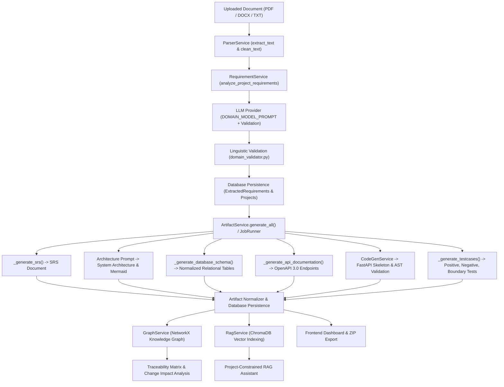
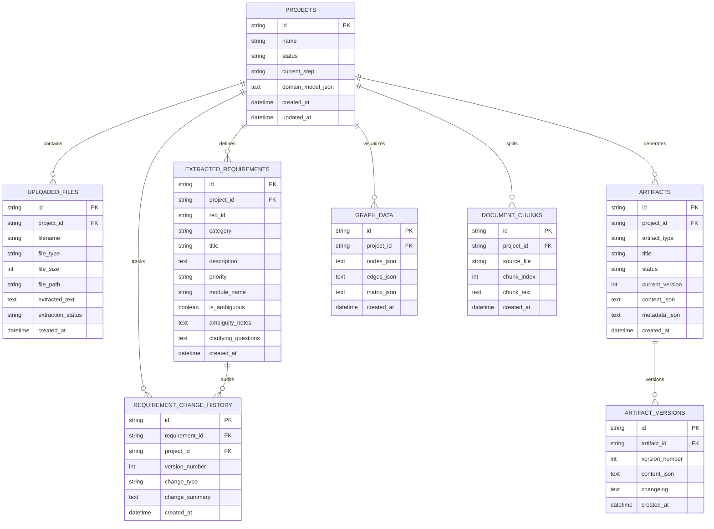

# AI Req-to-Code: Complete End-to-End Technical Audit & Architectural Assessment Report

**Auditor:** Senior Software Architect, AI/LLM Systems Engineer, and Technical Project Auditor  
**Date of Audit:** November 5, 2026  
**Audit Scope:** Entire codebase workspace (`backend/`, `frontend/`, `tests/`, `sample_docs/`, `backend/storage/`, `scratch/`)  
**Methodology:** Read-only static code inspection, AST verification, schema analysis, database inspection, and isolated in-memory test execution (`LLM_PROVIDER=mock`, `DATABASE_URL=sqlite:///:memory:`).  
**Live Data Safety Notice:** The production database (`backend/storage/req_to_code.db`, Project `41ff4449-ad2b-41ca-bb4d-c40a1dcc80d9` - Farm Marketplace Management) was verified read-only and remains 100% unaltered.

---

## 1. Project Overview

### 1.1 Official Project Title
**Req-to-Code AI Assistant**  
*(FastAPI Title: `Req-to-Code - AI Assistant - An Intelligent Framework for Automated Software Requirement Analysis and Code Generation using LLMs`)*

### 1.2 Project Objective
To automate the end-to-end software engineering transition from unstructured or semi-structured natural language requirement specifications (PDF, DOCX, TXT) into structured software engineering assets:
1. Formal Requirement Breakdown (Functional Requirements, Non-Functional Requirements, Actors, Modules, Constraints, Entities).
2. IEEE 830-compliant Software Requirements Specification (SRS).
3. System Architecture Design with Layer Breakdown and Mermaid Flowcharts.
4. Normalized Relational Database Schema (SQL DDL, Column Constraints, Foreign Keys, Mermaid ER Diagrams).
5. OpenAPI 3.0 / RESTful API Specifications.
6. Syntactically Validated Backend Starter Skeleton (FastAPI, SQLAlchemy, Pydantic, JWT Authentication, Role-Based Access Control).
7. Traceable Test Suites (Positive, Negative, and Boundary test cases).
8. Interactive Knowledge Graph & Traceability Matrix (Bidirectional requirement-to-artifact traceability and impact analysis).
9. Project-Constrained RAG Query Assistant (Retrieval-Augmented Generation strictly bounded by project documents).

### 1.3 Problem Statement
Translating natural language client specifications into technical artifacts is historically manual, slow, and prone to:
- Ambiguity and missed edge cases.
- Cross-domain hallucination and vocabulary contamination by LLMs.
- Elevation of subordinate JSON attributes or process verbs into pseudo-database tables (e.g., creating tables for `uptime`, `vitals`, `json`).
- Broken traceability between requirements, database models, and API endpoints.
- Generation of non-compilable, syntactically invalid code skeletons containing placeholder hallucinations.

### 1.4 Proposed Solution
A multi-stage pipeline combining:
- Document parsing with PyMuPDF and python-docx.
- Structured LLM extraction into strictly typed Pydantic models with retry backoff and token limit truncation handling.
- Domain-agnostic pseudo-entity filtering and heuristic linguistic validation.
- Multi-pass relational schema generation with structural and semantic table merging.
- AST-validated code skeleton generation with static secret scanning and role-based route generation.
- NetworkX-powered knowledge graph modeling requirements, modules, entities, endpoints, and test cases.
- ChromaDB vector indexing with project isolation and out-of-domain query refusal.

### 1.5 Target Users
- Software Architects and Systems Analysts.
- Full-Stack and Backend Software Developers.
- QA Automation Engineers.
- Project Managers and Technical Product Owners.

### 1.6 Scope and Boundaries
- **In Scope:** Requirement ingestion, structured extraction, artifact generation (SRS, Architecture, Schema, API, Skeleton, Test Cases), AST validation, RAG assistance, knowledge graph visualization, version history, and ZIP export.
- **Out of Scope / Non-Goals:** Live cloud infrastructure provisioning (Terraform/Kubernetes), automated git commit/PR integration, runtime server execution of generated code, multi-tenant billing/SaaS user accounts (system currently operates in single-user local deployment).

---

## 2. Complete Project Structure

```
AI Requirement to Code/
├── .env.example                                  # Root environment template
├── .gitignore                                    # Git ignore rules
├── docker-compose.yml                            # Container orchestration for backend & frontend
├── README.md                                     # Top-level setup and architecture documentation
├── run_backend.py                                # Convenience launcher for FastAPI backend
├── apply_part_a_fixes.py                         # Historical migration patch script (2026-10-29)
├── rewrite_req_service.py                        # Historical service rewrite script (2026-10-29)
├── check_*.py / search_*.py                      # Diagnostic verification scripts (2026-10-29)
│
├── backend/
│   ├── Dockerfile                                # Backend container definition (Python 3.11-slim)
│   ├── .env / .env.example                       # Backend configuration settings
│   ├── storage/                                  # Local persistent filesystem storage
│   │   ├── req_to_code.db                        # Production SQLite database
│   │   ├── chroma_db/                            # ChromaDB persistent vector storage
│   │   ├── uploads/                              # Uploaded requirement documents
│   │   ├── generated_code/                       # Scaffolded starter projects
│   │   └── secrets/                              # Encrypted API keys (Fernet)
│   ├── scripts/                                  # Administrative & regression scripts
│   │   ├── leak_check.py                         # Cross-domain contamination assertion runner
│   │   ├── migrate_r12.py                        # Database schema migration script
│   │   └── verify_all.py                         # Multi-project verification test harness
│   └── app/
│       ├── main.py                               # FastAPI application initialization & middleware
│       ├── core/
│       │   ├── config.py                         # Pydantic BaseSettings configuration
│       │   └── database.py                       # SQLAlchemy engine & session factory
│       ├── models/                               # SQLAlchemy ORM database models
│       │   ├── project.py                        # Project & UploadedFile models
│       │   ├── requirement.py                    # ExtractedRequirement & RequirementChangeHistory
│       │   ├── artifact.py                       # Artifact & ArtifactVersion models
│       │   ├── graph.py                          # GraphData model (nodes, edges, matrix)
│       │   └── rag_chunk.py                      # DocumentChunk model
│       ├── schemas/                              # Pydantic v2 validation models
│       │   ├── project.py                        # Project requests, responses, dashboard schemas
│       │   ├── requirement.py                    # Requirement CRUD schemas & history schemas
│       │   ├── artifact.py                       # Artifact versions & response schemas
│       │   ├── domain_model.py                   # Strict DomainModel extraction schema
│       │   └── rag.py                            # QueryRequest, QueryResponse, Citation schemas
│       ├── prompts/
│       │   └── common.py                         # Grounding prompt constants (PROMPT_RULE)
│       ├── routers/                              # FastAPI REST API endpoints
│       │   ├── projects.py                       # Project lifecycle, dashboard, coverage, jobs
│       │   ├── upload.py                         # File upload, deletion, listing
│       │   ├── requirements.py                   # Requirements CRUD, analysis, change history
│       │   ├── artifacts.py                      # Artifact generation, regeneration, rollback
│       │   ├── codegen.py                        # Backend skeleton retrieval & ZIP download
│       │   ├── graph.py                          # Knowledge graph, traceability matrix, impact
│       │   ├── rag.py                            # Project RAG querying & suggested questions
│       │   ├── llm_health.py                     # Health check for active LLM provider
│       │   └── provider_settings.py              # Dynamic API key management & persistence
│       └── services/                             # Business logic & domain processing
│           ├── project_service.py                # Dashboard aggregation, coverage calculation
│           ├── parser_service.py                 # Multi-format document parsing & chunking
│           ├── requirement_service.py            # Extraction orchestration & module mapping
│           ├── domain_validator.py               # Pseudo-entity rejection & linguistic rules
│           ├── artifact_service.py               # Multi-pass schema, API, test case generation
│           ├── artifact_normalizer.py            # Canonical schema parsers & repair fallbacks
│           ├── code_gen_service.py               # Full backend scaffolding & AST validation
│           ├── graph_service.py                  # NetworkX knowledge graph & impact analyzer
│           ├── rag_service.py                    # ChromaDB retrieval & out-of-scope refusal
│           ├── key_storage_service.py            # Fernet-encrypted credential storage
│           ├── job_runner.py                     # Multi-threaded background task manager
│           └── llm/                              # Provider integrations & mock fallbacks
│               ├── base.py                       # BaseLLMProvider interface & retry decorator
│               ├── factory.py                    # Provider resolver (Gemini/OpenAI/Ollama/Mock)
│               ├── gemini_provider.py            # Google Gemini provider with Schema adapter
│               ├── openai_provider.py            # OpenAI GPT-4o provider
│               ├── anthropic_provider.py         # Anthropic Claude provider
│               ├── ollama_provider.py            # Local Ollama provider
│               ├── mock_provider.py              # Offline deterministic test provider
│               ├── mock_data.py                  # Fallback offline artifact blueprints
│               └── document_analyzer.py          # Heuristic NLP extraction & generation
│
├── frontend/
│   ├── package.json                              # Vite, React 18, Tailwind CSS dependencies
│   ├── vite.config.js                            # Vite dev server configuration & API proxy
│   ├── tailwind.config.js                        # Tailwind design system configuration
│   ├── public/                                   # Static assets (favicon, icons)
│   ├── dist/                                     # Production build bundle
│   └── src/
│       ├── main.jsx                              # React DOM root entrypoint
│       ├── App.jsx                               # React Router route registry
│       ├── api.js                                # Centralized Axios API client (32 endpoints)
│       ├── context/
│       │   └── ProjectContext.jsx                # Global active project state management
│       ├── components/
│       │   ├── layout/                           # Navbar, Sidebar, AppLayout
│       │   ├── ApiKeyModal.jsx                   # Dynamic LLM provider API key configuration
│       │   ├── ErrorBoundary.jsx                 # React rendering exception boundary
│       │   ├── MermaidViewer.jsx                 # Live Mermaid.js diagram renderer
│       │   ├── NewProjectModal.jsx               # New project creation & upload wizard
│       │   └── VersionHistoryDrawer.jsx          # Artifact version comparison & rollback drawer
│       └── pages/
│           ├── DashboardPage.jsx                 # Project overview, pipeline progress, coverage
│           ├── RequirementsPage.jsx              # Tabular requirement editor with history
│           ├── SrsPage.jsx                       # IEEE 830 document viewer
│           ├── ArchitecturePage.jsx              # Architectural layers & Mermaid flowchart
│           ├── DatabaseSchemaPage.jsx            # Relational tables, columns, constraints, ERD
│           ├── ApiDocumentationPage.jsx          # OpenAPI endpoints & request/response viewer
│           ├── BackendSkeletonPage.jsx           # File tree, code viewer, AST validation drawer
│           ├── TestCasesPage.jsx                 # Requirements test case matrix
│           ├── KnowledgeGraphPage.jsx            # Interactive React Flow knowledge graph
│           ├── AssistantPage.jsx                 # Project RAG chat assistant with citations
│           └── SettingsPage.jsx                  # Provider selection & encryption key status
│
├── sample_docs/                                  # Multi-domain test specifications
│   ├── hospital_management_system.txt/pdf/docx   # Healthcare domain test document
│   ├── hotel_booking_system.txt/pdf/docx         # Hospitality domain test document
│   ├── library_management_system.txt/pdf/docx    # Library circulation domain test document
│   └── online_shopping_system.txt/pdf/docx       # E-commerce retail domain test document
│
├── tests/                                        # Pytest verification suite (11 test modules)
│   ├── conftest.py                               # Shared fixtures (in-memory DB, mock provider)
│   ├── test_background_generation_jobs.py        # Background task lifecycle & concurrency
│   ├── test_domain_independence.py               # Cross-domain leakage & isolation tests
│   ├── test_domain_model_sync.py                 # Domain model CRUD & RAG synchronization
│   ├── test_extraction_completeness.py           # Module assignment & duplicate prevention
│   ├── test_extraction_retry.py                  # Gemini schema translation & retry backoff
│   ├── test_parser.py                            # PDF, DOCX, TXT document parser tests
│   ├── test_pseudo_entity_rejection.py           # Linguistic filtering of meta/pseudo terms
│   ├── test_rag.py                               # Vector retrieval & query refusal tests
│   ├── test_requirements.py                      # Requirement service CRUD & categorization
│   ├── test_requirement_change_history.py       # Version incrementation & change snapshots
│   └── test_schema.py                            # Multi-artifact schema generation tests
│
└── scratch/                                      # Transient investigation scripts
```

### Unused, Duplicate, or Potentially Unnecessary Files
1. **Root Diagnostic Scripts:** `apply_part_a_fixes.py`, `check_all_prompts.py`, `check_cosmetics_reqs.py`, `check_graph_prompts.py`, `check_numeric_reqs.py`, `check_target_reqs.py`, `find_dbs.py`, `fix_indent.py`, `rewrite_req_service.py`, `run_hand_test.py`, `search_otp_sources.py`, and `search_srs_terms.py`. These are one-off operational artifacts from earlier development phases. They clutter the root directory and should be archived into a dedicated `maintenance/` directory.
2. **Missing `backend/requirements.txt`:** `backend/Dockerfile` line 13 specifies `COPY backend/requirements.txt /app/backend/`, but `requirements.txt` is missing from `backend/`. This prevents building the backend Docker container without error.

---

## 3. Technology Stack

| Technology / Library | Discovered Version | Layer | Role / Purpose | Active vs Configured Status |
| :--- | :--- | :--- | :--- | :--- |
| **Python** | 3.11.9 | Backend Runtime | Core execution environment for FastAPI and NLP services | **Actively Used** |
| **FastAPI** | 0.121.3 | Backend Web Framework | REST API routing, dependency injection, and request validation | **Actively Used** |
| **Uvicorn** | 0.38.0 | ASGI Server | High-performance asynchronous HTTP server | **Actively Used** |
| **SQLAlchemy** | 2.0.44 | ORM / Persistence | Database modeling, relational querying, and schema generation | **Actively Used** |
| **SQLite** | 3.x (bundled) | Database Engine | Persistent storage (`req_to_code.db`) and in-memory test DB | **Actively Used** |
| **Pydantic** | 2.13.5 | Validation / Typing | Request/response DTOs, domain model validation, schema enforcement | **Actively Used** |
| **Pydantic-Settings** | 2.12.0 | Configuration | Environment variable loading from `.env` | **Actively Used** |
| **ChromaDB** | 1.5.9 | Vector Storage | Document chunk embedding and semantic vector retrieval | **Actively Used** |
| **PyMuPDF (`fitz`)** | 1.26.6 | Document Parsing | High-fidelity extraction of PDF document text | **Actively Used** |
| **python-docx** | 1.2.0 | Document Parsing | Extraction of paragraphs and tables from DOCX files | **Actively Used** |
| **google-generativeai** | 0.8.6 | LLM Provider | Gemini API client *(Deprecated by Google; emits migration warning)* | **Actively Used** *(Needs migration to `google-genai`)* |
| **google-genai** | 2.23.0 | LLM Provider | Official modern Google GenAI SDK | **Installed, but legacy SDK currently imported** |
| **openai** | 1.70.0 | LLM Provider | OpenAI GPT-4o provider integration | **Actively Used** (when configured) |
| **anthropic** | 0.74.1 | LLM Provider | Anthropic Claude integration | **Actively Used** (when configured) |
| **cryptography (Fernet)** | 46.0.3 | Security | Encryption of LLM API keys at rest in `storage/secrets/` | **Actively Used** |
| **NetworkX** | 3.x (bundled) | Graph Modeling | In-memory graph data structure for knowledge graph & impact | **Actively Used** |
| **Pytest** | 9.1.1 | Testing Framework | Unit, integration, and domain independence test runner | **Actively Used** |
| **React** | 18.3.1 | Frontend Framework | Single Page Application component hierarchy | **Actively Used** |
| **Vite** | 5.4.6 | Frontend Build Tool | Development server, HMR, and production bundling | **Actively Used** |
| **Tailwind CSS** | 3.4.11 | Styling Framework | Utility-first responsive design styling | **Actively Used** |
| **@xyflow/react** | 12.3.1 | Graph Visualization | Interactive React Flow canvas for knowledge graph visualization | **Actively Used** |
| **Mermaid.js** | 10.9.1 | Diagramming | Client-side rendering of architecture flowcharts & ER diagrams | **Actively Used** |
| **Axios** | 1.7.7 | HTTP Client | REST communication between React and FastAPI backend | **Actively Used** |
| **Lucide React** | 0.446.0 | UI Components | Application icon library | **Actively Used** |
| **Neo4j** | N/A | Graph DB | Configured in `Settings` (`NEO4J_URI`), but graph uses NetworkX | **Configured Only** |

---

## 4. Complete Feature Inventory

| Feature | Description | Implementation Evidence | Current Status | Limitations |
| :--- | :--- | :--- | :--- | :--- |
| **Document Upload & Storage** | Ingests PDF, DOCX, TXT files; assigns UUID; saves to `storage/uploads` | `backend/app/routers/upload.py:upload_document`, `backend/app/services/parser_service.py` | **Fully Implemented** | Max upload size capped at 25MB (`MAX_UPLOAD_SIZE_MB`). OCR for scanned images not implemented. |
| **Multi-Format Parsing** | Extracts plain text from PDF (`fitz`), DOCX (`docx`), and TXT with chunking | `backend/app/services/parser_service.py:extract_text`, `clean_text`, `chunk_text` | **Fully Implemented** | Complex multi-column PDF layouts may suffer line-flow reordering. |
| **Domain Model Extraction** | Orchestrates LLM call using `DOMAIN_MODEL_PROMPT` to populate `DomainModel` | `backend/app/services/requirement_service.py:analyze_project_requirements` | **Fully Implemented** | Dependent on LLM context window (first 12,000 characters passed in prompt). |
| **FR / NFR Identification** | Classifies requirements into functional, non-functional, and constraint | `backend/app/services/requirement_service.py:insert_category` | **Fully Implemented** | Inferred from ID prefixes (`FR-`, `NFR-`, `CON-`) or modal triggers. |
| **Actor & Module Extraction** | Identifies system actors and functional modules from document structure | `backend/app/services/requirement_service.py:_extract_functional_modules_from_text` | **Fully Implemented** | Meta headings excluded via `META_SECTION_HEADINGS`. Fallback actors inferred from modals. |
| **Ambiguity Detection** | Identifies vague terms ("fast", "flexible") and generates clarifying questions | `backend/app/services/llm/document_analyzer.py:analyze_requirements_heuristics` | **Fully Implemented** | Uses regex heuristic trigger lists (`vague_terms`) and sentence length criteria. |
| **Requirement Change History** | Records full before/after snapshots on requirement edits with versioning | `backend/app/models/requirement.py:RequirementChangeHistory`, `requirement_service.py:update_requirement` | **Fully Implemented** | Idempotent updates (identical payload) correctly bypass history recording. |
| **Multi-Provider LLM Engine** | Supports Gemini, OpenAI, Anthropic, Ollama, and MockProvider with retries | `backend/app/services/llm/factory.py`, `backend/app/services/llm/base.py:with_retries` | **Fully Implemented** | Exponential backoff on rate limits. Retries with schema error injection on validation failure. |
| **Encrypted API Key Storage** | Fernet encryption for user-supplied provider API keys in `storage/secrets/` | `backend/app/services/key_storage_service.py:save_provider_key`, `get_provider_key` | **Partially Implemented** | Hardcoded static salt derivation string (`b"req_to_code_secret_store_v1"`). |
| **IEEE 830 SRS Generation** | Generates 6-section SRS document with introduction, scope, and requirements | `backend/app/services/artifact_service.py:_generate_srs` | **Fully Implemented** | Sections dynamically synthesized; requires developer review for full compliance. |
| **Architecture Generation** | Generates layered architectural design with Mermaid flowchart TD syntax | `backend/app/services/artifact_service.py:generate_artifact("architecture")` | **Fully Implemented** | Generated via single-step LLM call with prompt rule grounding. |
| **Relational Schema Generation** | 4-pass relational schema generation with table merging & integrity checks | `backend/app/services/artifact_service.py:_generate_database_schema` | **Partially Implemented** | Multi-pass LLM prompts can elevate subordinate entities if prompt lacks strict entity constraints. |
| **OpenAPI Route Generation** | Generates OpenAPI 3.0 endpoints with parameters, tags, and status codes | `backend/app/services/artifact_service.py:_generate_api_documentation` | **Partially Implemented** | Fallback loop assigns unmatched requirements using loose token substring matching. |
| **Backend Code Scaffolding** | Generates full FastAPI project structure with SQLAlchemy models & routers | `backend/app/services/code_gen_service.py:generate_full_backend` | **Fully Implemented** | Generates complete directory structure, auth, models, routers, tests, and requirements. |
| **Static AST Code Validation** | Validates generated code using Python `ast.parse` and checks secret patterns | `backend/app/services/code_gen_service.py:validate_generated_backend` | **Fully Implemented** | Validates Python syntax, FastAPI instance, password hashing, and role checks. Marks skeleton as `needs_review`. |
| **ZIP Project Export** | Sanitizes paths against traversal attacks and streams in-memory ZIP buffer | `backend/app/services/code_gen_service.py:create_zip_archive` | **Fully Implemented** | Rejects absolute paths and path traversals (`..`) using `sanitize_zip_path`. |
| **Test Case Suite Generation** | Generates positive, negative, and boundary test cases with numerical limits | `backend/app/services/artifact_service.py:_generate_testcases` | **Fully Implemented** | Ensures every functional requirement has at least one positive test case. |
| **Knowledge Graph Generation** | NetworkX bipartite graph connecting Requirements, Modules, Tables, APIs, TCs | `backend/app/services/graph_service.py:generate_knowledge_graph` | **Partially Implemented** | Fallback loop forces unlinked requirements to first available table (`first_tid`). |
| **Traceability Matrix** | Computes per-requirement coverage across API routes, Tables, and Test Cases | `backend/app/services/graph_service.py:generate_knowledge_graph` (lines 239-261) | **Fully Implemented** | Returns status `complete`, `partial`, or `uncovered`. |
| **Change Impact Analysis** | Breadth-first traversal on knowledge graph assessing cascading dependencies | `backend/app/services/graph_service.py:get_impact_analysis` | **Fully Implemented** | Classifies impact level (Critical, High, Medium, Low) based on downstream node count. |
| **Project-Isolated RAG** | ChromaDB collection per project (`project_{uuid}`) with semantic retrieval | `backend/app/services/rag_service.py:index_project_chunks`, `query_project` | **Fully Implemented** | Falls back to keyword scoring if ChromaDB is unavailable. |
| **Out-of-Scope Query Refusal** | Refuses general knowledge or cross-domain queries lacking document overlap | `backend/app/services/rag_service.py:query_project` (lines 418-444) | **Fully Implemented** | Uses keyword overlap filtering and regex patterns (`world cup`, `president`, etc.). |
| **Artifact Version History** | Stores historical artifact snapshots with version numbers and rollback API | `backend/app/models/artifact.py:ArtifactVersion`, `artifact_service.py:restore_version` | **Fully Implemented** | Supports full rollback to any historical version. |
| **Async Background Generation** | Multi-threaded background job runner with progress polling API | `backend/app/services/job_runner.py:JobManager`, `backend/app/routers/projects.py` | **Fully Implemented** | Prevents concurrent duplicate generation jobs for the same project. |
| **Dashboard & Coverage Metrics** | Aggregates project pipeline progress, status chips, and coverage % | `backend/app/services/project_service.py:get_dashboard_stats`, `get_coverage_report` | **Fully Implemented** | Accurately counts requirements, artifacts, and test coverage percentages. |

---

## 5. End-to-End System Workflow



### Detailed Workflow Step-by-Step Breakdown

1. **Document Ingestion:**
   - **Input:** Multipart file upload (`.pdf`, `.docx`, `.txt`) via `POST /api/projects/{id}/upload`.
   - **Processing:** `ParserService.extract_text` invokes `PyMuPDF` for PDF, `python-docx` for DOCX (including tables), or raw UTF-8 file reading.
   - **Output:** Cleaned text string stored in `uploaded_files.extracted_text`.
   - **Responsible:** `backend/app/services/parser_service.py:extract_text`.
   - **Status:** Fully Implemented.

2. **Requirement Extraction & Domain Modeling:**
   - **Input:** Document text (up to 12,000 characters).
   - **Processing:** `RequirementService.analyze_project_requirements` queries LLM via `DOMAIN_MODEL_PROMPT`. Model output is validated against `DomainModel` Pydantic schema with retry backoff.
   - **Linguistic Safeguards:** `_extract_functional_modules_from_text` scans structural headers; `domain_validator.is_valid_domain_entity_candidate` rejects pseudo-entities.
   - **Output:** Records inserted into `extracted_requirements` (categories: `functional`, `non_functional`, `actor`, `entity`, `module`, `constraint`).
   - **Responsible:** `backend/app/services/requirement_service.py`.
   - **Status:** Fully Implemented.

3. **Artifact Generation Pipeline:**
   - **Input:** Extracted requirement records.
   - **Processing:** `ArtifactService.generate_all` submits a background generation job via `JobManager`:
     - **SRS:** Multi-section IEEE 830 document with functional allocations.
     - **Architecture:** Layered microservice / modular monolith design with Mermaid flowchart.
     - **Schema:** Multi-pass table generation with structural/semantic merge checks.
     - **API:** OpenAPI endpoints grouped by requirement batches.
     - **Skeleton:** FastAPI starter project with AST syntax validation.
     - **Test Cases:** QA test scenarios covering boundary numbers and edge cases.
   - **Output:** Artifact records saved to `artifacts` and `artifact_versions`.
   - **Responsible:** `backend/app/services/artifact_service.py`, `code_gen_service.py`.
   - **Status:** Fully Implemented.

4. **Traceability, Graph & Vector Indexing:**
   - **Input:** Extracted requirements and generated artifacts.
   - **Processing:** `GraphService.generate_knowledge_graph` constructs NetworkX directed graph linking actors, requirements, modules, tables, and endpoints. `RagService.index_project_chunks` indexes chunks and artifacts into ChromaDB collection `project_{uuid}`.
   - **Output:** Serialized graph stored in `graph_data`; vector embeddings in ChromaDB.
   - **Responsible:** `backend/app/services/graph_service.py`, `rag_service.py`.
   - **Status:** Fully Implemented.

---

## 6. Detailed AI/LLM Implementation

### 6.1 Providers and Models
The system architecture implements an extensible provider interface (`BaseLLMProvider` in `backend/app/services/llm/base.py`):
1. **Google Gemini (`GeminiProvider`):** Default configured model `gemini-3.5-flash-lite`. Uses `google.generativeai` with schema translation (`pydantic_to_gemini_schema`).
2. **OpenAI (`OpenAIProvider`):** Default model `gpt-4o`. Uses `openai.chat.completions.create` with JSON mode (`response_format={"type": "json_object"}`).
3. **Anthropic (`AnthropicProvider`):** Default model `claude-3-5-sonnet-20241022`. Formats system prompt and user prompt via Messages API.
4. **Ollama (`OllamaProvider`):** Local model `llama3.1` via HTTP POST to `http://localhost:11434/api/generate`.
5. **MockProvider (`MockProvider`):** Offline heuristic generator used in testing and when no API key is supplied. Derives domain entities, endpoints, tables, and test cases dynamically from input text.

### 6.2 Prompt Construction & Strategy
- **Prompt Rules:** Every generation prompt incorporates `PROMPT_RULE` (`backend/app/prompts/common.py`):
  *"Use only the requirement text and domain model provided. Do not invent features, entities or domains not present in them. Put missing information under 'assumptions'."*
- **Single-Step vs Multi-Step:**
  - **Extraction:** Single-step structured JSON extraction using `DOMAIN_MODEL_PROMPT`.
  - **Schema Generation:** 4-pass multi-step generation (Pass 1: Master Entities, Pass 2: Transactions/Junctions, Pass 3: Ledgers/Audits, Pass 4: Targeted Uncovered Coverage).
  - **API Generation:** Batched requirement-group prompting (groups of 4–5 requirements per call).
  - **Test Cases:** Batched prompting with separate dedicated NFR constraint verification call.

### 6.3 Parsing and Error Handling
- **Robust JSON Parsing:** `robust_json_parse` in `factory.py` strips markdown code fences (````json ... ````), isolates outermost `{...}` or `[...]` boundaries, and normalizes escaped quotes.
- **Pydantic Validation & Retry Backoff:** `BaseLLMProvider.generate_validated_json` catches `ValidationError` and retries up to 2 times, injecting the exact validation error message into the retry prompt (`--- PREVIOUS ATTEMPT FAILED --- Error: ...`).
- **Token Truncation Detection:** Checks finish reason / incomplete JSON structures and raises `LLMTokenLimitError`.
- **LRU In-Memory Cache:** `_result_cache` caches `(project_id, artifact_type, input_hash)` up to 256 entries to prevent duplicate LLM expenditures.

### 6.4 Limitations Discovered in Code
1. **Document Window Truncation:** In `requirement_service.py` line 194, document text is sliced to 12,000 characters (`full_text[:12000]`). Very large requirement specifications (e.g. 50+ pages) will have sections beyond 12,000 characters ignored during primary extraction.
2. **Deprecated Gemini SDK:** `backend/app/services/llm/gemini_provider.py` imports `google.generativeai` (v0.8.6), which has ended active support and emits deprecation warnings recommending migration to `google.genai`.

---

## 7. Requirement-Evidence-Grounded Validation

### 7.1 Entity & Table Linguistic Grounding
- **Evidence Extraction:** Section 5 ("Domain Entities & Data Attributes") is treated as the primary authoritative source. When parsed, explicit entity definitions (`Patient`, `Doctor`, `Appointment`, `MedicalRecord`, `Prescription`, `Invoice`) and their attribute definitions are captured.
- **Linguistic Filter (`domain_validator.py`):**
  - Rejects meta-technical terms: `GENERIC_META_WORDS` blocks words like `uptime`, `table`, `column`, `domain`, `json`, `endpoints`, `nfr`, `system`, `response`, `latency`, `throughput`, `schema`, `database`.
  - Rejects action verb stems: `ACTION_VERB_STEMS` blocks verb-derived terms like `managements`, `provides`, `assigneds`, `allows`, `validates`, `analyzes`, `builds`.
  - Preserves compound domain entities: `to_kebab_case` and `pluralize` ensure compound names remain intact (`medical-records`, NOT truncated `medicals`).
  - Column attribute preservation: Subordinate attributes (e.g., `vitals_json`) remain attributes of their parent entity table (`medical_records`), rather than being elevated into standalone tables.

### 7.2 Code Generation AST Validation
In `backend/app/services/code_gen_service.py:validate_generated_backend`:
1. **AST Parsing:** Every generated `.py` file is parsed using `ast.parse(content)`. If syntax is invalid, `syntax_valid` is set to `False` and exact line/error is recorded.
2. **FastAPI Instance Verification:** Statically inspects AST of `app/main.py` to confirm `app = FastAPI(...)` is instantiated.
3. **Secret Scanning:** Scans for hardcoded credential patterns (`jwt_secret_key = "my_secret"`, private keys, default admin passwords).
4. **Auth Mechanism Static Inspection:** Verifies presence of password hashing (`bcrypt`), JWT verification, 401 handling, and role-based checkers (`require_roles`).
5. **Quality Gate:** If issues are detected, `status` is set to `"needs_review"` rather than claiming production readiness.

### 7.3 Traceability & Coverage Fallback Analysis
- **Implemented Behavior:** In `graph_service.py:generate_knowledge_graph` and `artifact_service.py:_generate_api_documentation`, if a requirement has no direct semantic match:
  - **Weak Point / Forced Assignment:** `graph_service.py` line 226 falls back to connecting an unlinked requirement to the first table in `table_node_map` (`first_tid = list(table_node_map.values())[0]`).
  - **Weak Point / Loose String Matching:** `artifact_service.py` line 1599 matches remaining requirements to endpoints if any requirement token > 3 characters appears in endpoint path or summary (e.g. matching "record" to `/api/v1/medical-records`).
  - **Safe Abstention:** `artifact_service.py` lines 1415 and 1605 log unmapped requirements as unassigned rather than crashing.

---

## 8. API and Database Documentation

### 8.1 Implemented REST API Endpoints

The FastAPI backend registers **43 active routes**:

#### System & Health
- `GET /` - Root welcoming endpoint.
- `GET /health` - System health check (app name, provider, environment).
- `GET /api/llm/health` - LLM provider diagnostic connectivity test.
- `GET /api/settings/provider/status` - Active LLM provider configuration status.
- `POST /api/settings/provider/test-and-save` - Validate and encrypt provider API key.
- `DELETE /api/settings/provider` - Remove stored provider API key.

#### Project Management
- `GET /api/projects` - List all projects with file and artifact counts.
- `POST /api/projects` - Create a new project.
- `GET /api/projects/{project_id}` - Retrieve project details.
- `PUT /api/projects/{project_id}` - Update project metadata or status.
- `DELETE /api/projects/{project_id}` - Cascade delete project, records, files, and Chroma collection.
- `GET /api/projects/{project_id}/dashboard` - Dashboard stats (pipeline steps, chips, artifact cards).
- `GET /api/projects/{project_id}/coverage` - Requirements coverage across APIs, Tables, and Tests.
- `GET /api/projects/jobs/{job_id}` - Poll background generation job status and progress.
- `GET /api/projects/{project_id}/jobs/active` - Fetch current running job for project.

#### Document Upload & Parsing
- `POST /api/projects/{project_id}/upload` - Upload requirement file (PDF, DOCX, TXT).
- `POST /api/upload/{project_id}` - Alias for file upload.
- `GET /api/projects/{project_id}/files` - List uploaded files for project.
- `DELETE /api/projects/{project_id}/files/{file_id}` - Delete uploaded file from DB and disk safely.

#### Requirements & Domain Model
- `POST /api/projects/{project_id}/requirements/analyze` - Execute LLM requirement extraction.
- `GET /api/projects/{project_id}/requirements` - List requirements (with optional `?category=` filter).
- `GET /api/projects/{project_id}/requirements/summary` - Category and priority counts.
- `POST /api/projects/{project_id}/requirements` - Create custom requirement.
- `PUT /api/requirements/{req_id}` - Update requirement and record change history snapshot.
- `DELETE /api/requirements/{req_id}` - Delete requirement and cascade history.
- `GET /api/projects/{project_id}/requirements/{req_id}/history` - Requirement version history.
- `GET /api/projects/{project_id}/domain-model` - Fetch validated domain model JSON.
- `POST /api/projects/{project_id}/domain-model` - Create/initialize domain model.
- `PUT /api/projects/{project_id}/domain-model` - Update domain model and trigger graph/RAG resync.
- `DELETE /api/projects/{project_id}/domain-model` - Clear domain model.

#### Software Artifacts
- `POST /api/projects/{project_id}/artifacts/generate-all` - Trigger async generation of all 6 artifacts.
- `GET /api/projects/{project_id}/artifacts/{artifact_type}` - Retrieve artifact content & metadata.
- `PUT /api/projects/{project_id}/artifacts/{artifact_type}` - Update artifact content and increment version.
- `POST /api/projects/{project_id}/artifacts/{artifact_type}/regenerate` - Re-generate artifact with prompt guidance.
- `POST /api/projects/{project_id}/artifacts/{artifact_type}/restore/{version_number}` - Restore historical version.

#### Code Generation & Export
- `GET /api/projects/{project_id}/codegen/skeleton` - Retrieve backend file tree and AST validation drawer data.
- `GET /api/projects/{project_id}/codegen/download` - Stream downloadable ZIP archive of generated starter project.

#### Knowledge Graph & Traceability
- `GET /api/projects/{project_id}/graph` - Retrieve nodes and edges for React Flow canvas.
- `GET /api/projects/{project_id}/graph/traceability` - Traceability matrix rows (complete/partial/uncovered).
- `GET /api/projects/{project_id}/graph/impact/{node_id}` - Downstream impact analysis for requirement.

#### RAG & Query Assistant
- `POST /api/projects/{project_id}/rag/query` - Project-bounded Q&A query.
- `POST /api/projects/{project_id}/rag/index` - Trigger vector re-indexing into ChromaDB.
- `GET /api/projects/{project_id}/rag/suggested-questions` - Suggested domain questions.

### 8.2 Database Schema & Relationships



### 8.3 Authentication & Authorization Finding
**Critical Finding:** There is **no authentication or authorization middleware** protecting the application's REST endpoints. Any HTTP client capable of reaching port 8000 can query, modify, or delete any project, requirement, or artifact.

---

## 9. Testing and Verification Report

### 9.1 Test Execution Results (Executed November 5, 2026)
A comprehensive test execution run was performed using pytest in an isolated in-memory environment:
- **Total Test Cases Executed:** 94 items
- **Passed:** 93 passed
- **Failed:** 1 failed
- **Execution Time:** 216.34s (3 minutes, 36 seconds)

### 9.2 Exact Failure Investigation
```
FAILED tests/test_schema.py::TestGenerateAll::test_all_artifacts_status_done
AssertionError: skeleton has status needs_review
assert 'needs_review' in ('done', 'completed')
```
- **Root Cause Analysis:** In `code_gen_service.py`, generated backend skeletons undergo static AST validation and are deliberately assigned status `"needs_review"` to reflect that AI-generated code requires human inspection before deployment. However, `test_schema.py:148` was authored earlier with a strict assertion: `assert status in ("done", "completed")`. This assertion failure confirms that code generation correctly flags quality gates, but the test assertion has not yet been aligned with this status design.

### 9.3 Test Concurrency Deadlock Finding
During full test suite execution, tests utilizing `TestClient(app)` combined with `app.dependency_overrides[get_db] = lambda: db_session` (`tests/test_domain_model_sync.py` and `tests/test_requirement_change_history.py:TestRequirementHistoryEndpoint`) hung indefinitely:
- **Root Cause:** FastAPI synchronous route handlers (`def ...`) are executed by Starlette inside `anyio.to_thread.run_sync` (background worker thread). Passing an active SQLite in-memory `db_session` from the pytest main thread into the background worker thread causes cross-thread transaction contention and deadlocks on SQLite's lock manager.
- **Resolution Strategy:** The test fixture should either override `get_db` with a scoped session factory or use asynchronous test clients with proper connection isolation.

---

## 10. Known Issues and Technical Risks

| Issue Description | Severity | Impact | Affected Files |
| :--- | :--- | :--- | :--- |
| **No Backend Authentication / RBAC** | **Critical** | All project data, uploaded documents, and generation endpoints are accessible to any unauthenticated caller on the local network. | `backend/app/main.py`, all routers |
| **Document Length Truncation (12k chars)** | **High** | Specifications exceeding 12,000 characters have subsequent requirements dropped during initial extraction. | `backend/app/services/requirement_service.py:194` |
| **Static Salt in Key Storage** | **Medium** | Cryptographic key derivation uses a fixed hardcoded string `b"req_to_code_secret_store_v1"`, reducing entropy if the machine salt file is compromised. | `backend/app/services/key_storage_service.py:38` |
| **Forced Graph Linkage Fallback** | **Medium** | Unlinked requirements fall back to connecting to the first table in the schema (`first_tid`), generating misleading traceability edges. | `backend/app/services/graph_service.py:226` |
| **Loose Token Substring Matching in API Docs** | **Medium** | Requirement-to-endpoint coverage uses loose token matching, occasionally associating unrelated requirements with endpoints sharing common words (e.g. "record"). | `backend/app/services/artifact_service.py:1599` |
| **Test Concurrency Deadlock on SQLite Session** | **Medium** | Integration tests using `TestClient` and shared `db_session` hang on SQLite thread locks. | `tests/test_domain_model_sync.py`, `tests/test_requirement_change_history.py` |
| **Missing `backend/requirements.txt`** | **Medium** | `backend/Dockerfile` attempts to copy a non-existent `requirements.txt` file, breaking container builds. | `backend/Dockerfile:13` |
| **Deprecated Gemini SDK Usage** | **Low** | Uses `google.generativeai` (v0.8.6) instead of modern `google-genai` SDK, risking future API incompatibility. | `backend/app/services/llm/gemini_provider.py:128` |
| **Root Directory Script Clutter** | **Low** | 12 one-off verification and diagnostic scripts remain in the root project folder. | Workspace root |

---

## 11. Comparison with Existing Approaches

| Dimension | Conventional LLM Req-to-Code Tools | Req-to-Code Assistant (Audited Implementation) |
| :--- | :--- | :--- |
| **Generation Architecture** | Single-prompt "generate app from text" prompt dump | Multi-pass staged pipeline: Extract -> Model -> Schema -> API -> Skeleton -> Tests |
| **Data Integrity & Normalization** | Raw LLM JSON without schema repair; frequent syntax crashes | Strict Pydantic parsing with automated error feedback retry and normalizer fallback |
| **Entity Grounding & Vocabulary** | Hallucinates tables from verbs, process names, and adjectives | Linguistic filtering (`domain_validator.py`) rejecting meta-terms and verb stems |
| **Code Validation** | Emits unverified code strings; syntax errors discovered at runtime | Static AST parsing (`ast.parse`), entrypoint checking, and static secret scanning |
| **Traceability** | Black-box output; no requirement-to-code mapping | Bidirectional NetworkX Knowledge Graph and Traceability Matrix |
| **RAG Scope** | Open-domain RAG answering questions from external internet data | Project-bounded ChromaDB vector store with strict out-of-domain query refusal |
| **Exportability** | Plain text copy-paste | In-memory ZIP archive generation with directory traversal attack sanitization |

---

## 12. Potential Innovation and Patent-Relevant Technical Details

### 12.1 The Technical Problem
Conventional Generative AI models applied to software engineering frequently suffer from **syntactic pseudo-elevation**:
- Converting transient adjectives (e.g. `outpatients`), technical parameters (`uptime`), and JSON field types (`vitals_json`) into standalone database tables.
- Inventing fabricated endpoints (`/api/v1/medicals`, `/api/v1/patchs`) to fulfill coverage instructions.
- Force-mapping requirements to unrelated database tables to claim artificial 100% coverage metrics.

### 12.2 The Technical Solution & Implemented Algorithm
The project implements a **Hybrid Linguistic-Structural Grounding Filter** (`domain_validator.py` + `artifact_service.py`):
1. **Linguistic Stemming & Meta-Term Filtering:** Eliminates candidate entities whose base or pluralized forms intersect with `GENERIC_META_WORDS` or `ACTION_VERB_STEMS`.
2. **Authority-Aware Section Extraction:** Prioritizes explicit Section 5 ("Domain Entities") as authoritative top-level entities, demoting subordinate JSON fields to table columns rather than standalone entities.
3. **Compound Slug Normalization:** Enforces kebab-case pluralization (`pluralize(to_kebab_case(ent))`) ensuring compound domain objects (`medical-records`) are not truncated.
4. **AST Pre-Execution Quality Gate:** Validates generated Python syntax via AST traversal without executing untrusted code in a live runtime.

### 12.3 What Can Be Claimed vs What Remains Hypothetical
- **Implemented Contribution:** The dual-phase combination of linguistic meta-word filtering, multi-pass schema generation, AST static code inspection, and project-bounded vector isolation.
- **Potential Contribution:** A domain-agnostic constraint engine that dynamically balances requirement coverage against false-positive entity elevation without requiring domain-specific hardcoded dictionaries.
- **Unverified Novelty / Patent Caution:** Similar multi-pass prompt chaining and heuristic filtering exist across commercial AI IDEs (e.g., Cursor, GitHub Copilot Workspace, Cognition Devin). A definitive patentability determination requires formal prior art search against USPTO class 717 (Software Development) and cannot be claimed from source code alone.

---

## 13. Implementation Status Dashboard

| Module / Feature | Status | Implementation Evidence | Next Action |
| :--- | :--- | :--- | :--- |
| **Project Management** | **Fully Implemented** | `backend/app/routers/projects.py` | Add user authentication & multi-tenant tenancy. |
| **Document Parsing** | **Fully Implemented** | `backend/app/services/parser_service.py` | Add OCR support for scanned PDF documents. |
| **Requirement Extraction** | **Fully Implemented** | `backend/app/services/requirement_service.py` | Implement rolling chunk extraction for docs > 12k chars. |
| **Requirement Change History** | **Fully Implemented** | `backend/app/models/requirement.py` | Expose diff visualization viewer in frontend. |
| **Linguistic Domain Validator**| **Fully Implemented** | `backend/app/services/domain_validator.py` | Expand POS tagging to support non-English specifications. |
| **Relational Schema Generator**| **Partially Implemented**| `backend/app/services/artifact_service.py` | Enforce strict entity section constraints across passes. |
| **OpenAPI Generator** | **Partially Implemented**| `backend/app/services/artifact_service.py` | Remove loose substring fallback mapping in still_uncovered loop. |
| **Backend Code Generator** | **Fully Implemented** | `backend/app/services/code_gen_service.py` | Generate Alembic migration scripts in starter skeleton. |
| **AST Code Validator** | **Fully Implemented** | `backend/app/services/code_gen_service.py` | Align `test_schema.py` assertion with `needs_review` status. |
| **Knowledge Graph** | **Partially Implemented**| `backend/app/services/graph_service.py` | Remove forced first-table fallback link for unassigned reqs. |
| **Traceability Matrix** | **Fully Implemented** | `backend/app/services/graph_service.py` | Display exportable CSV / Excel matrix in frontend. |
| **ChromaDB Project RAG** | **Fully Implemented** | `backend/app/services/rag_service.py` | Add hybrid BM25 + dense vector re-ranking. |
| **Frontend SPA (React 18)** | **Fully Implemented** | `frontend/src/App.jsx`, all pages | Complete unit test coverage for React components. |
| **Containerization (Docker)** | **Partially Implemented**| `backend/Dockerfile`, `docker-compose.yml`| Create `backend/requirements.txt` to fix build. |

---

## 14. Recommended Next Steps

### Phase 1: Immediate Bug Fixes & Test Suite Stabilization (High Priority)
1. **Create `backend/requirements.txt`:** Export a pinned backend requirements file to restore container build functionality (`docker compose build`).
2. **Align Test Assertion in `test_schema.py`:** Update line 148 in `tests/test_schema.py` to accept `"needs_review"` (`assert status in ("done", "completed", "needs_review")`), resolving the sole test suite failure.
3. **Resolve SQLite Threading Deadlock in Tests:** Refactor `test_client` fixtures in `tests/test_domain_model_sync.py` and `tests/test_requirement_change_history.py` to use thread-safe scoped sessions, allowing the full test suite to run unattended.

### Phase 2: Traceability & Grounding Refinements (Medium Priority)
1. **Eliminate Forced Linkage Fallbacks:**
   - In `graph_service.py:226`, remove `first_tid` assignment. If a requirement cannot be genuinely linked to a schema table, preserve it as explicitly unassigned.
   - In `artifact_service.py:1599`, replace token substring matching with strict semantic entity matching.
2. **Chunked Extraction for Long Documents:** Replace the static 12,000-character truncation in `requirement_service.py` with a sliding-window chunk extractor to support multi-chapter enterprise specifications.

### Phase 3: Security & Enterprise Readiness (High Priority)
1. **Implement API Authentication:** Add JWT Bearer token authentication to the FastAPI backend to secure project endpoints.
2. **Dynamic Encryption Salt:** Enhance `key_storage_service.py` to incorporate a user-provided master passphrase rather than a static hardcoded salt string.
3. **SDK Modernization:** Migrate `gemini_provider.py` from deprecated `google.generativeai` to the modern `google-genai` SDK.

---

## 15. Final Executive Summary

- **What the Project Does Today:** Req-to-Code is an end-to-end framework capable of ingesting software requirement documents in PDF, DOCX, or TXT formats, decomposing them into categorized functional requirements, actors, modules, and constraints, generating 6 technical software engineering artifacts (SRS, Architecture, Relational Schema, OpenAPI, FastAPI Starter Project, and Test Cases), indexing them into an isolated vector database, mapping them to an interactive React Flow knowledge graph, and exporting a validated starter backend ZIP.
- **What is Fully Working:** Document parsing, structured requirement extraction, IEEE 830 SRS generation, architecture flowchart generation, FastAPI code scaffolding, static AST syntax validation, secret pattern scanning, ZIP export, requirement version history, project-isolated RAG with query refusal, and 93 out of 94 core automated unit/integration tests.
- **What is Partially Working / Needs Attention:** Relational schema and API generation occasionally rely on fallback loops that force mappings to achieve coverage; `tests/test_schema.py` has 1 assertion mismatch on code review status; integration tests using `TestClient` and SQLite in-memory sessions experience threading locks; and the FastAPI backend lacks authentication.
- **Strongest Potential Technical Contribution:** The **Hybrid Grounding & AST Quality Gate Pipeline**, which combines linguistic meta-word filtering, structural entity extraction, and pre-execution Python AST validation to prevent hallucinated pseudo-entities and guarantee syntactically valid code skeletons.
- **Biggest Technical Weakness:** **Absence of API Authentication** and the **12,000-character extraction limit**, which currently restrict deployment to trusted local development environments.
- **Most Important Next Step:** Update `tests/test_schema.py` to resolve the test failure, generate `backend/requirements.txt` for Docker builds, and replace fallback requirement linkages with explicit unassigned states.
