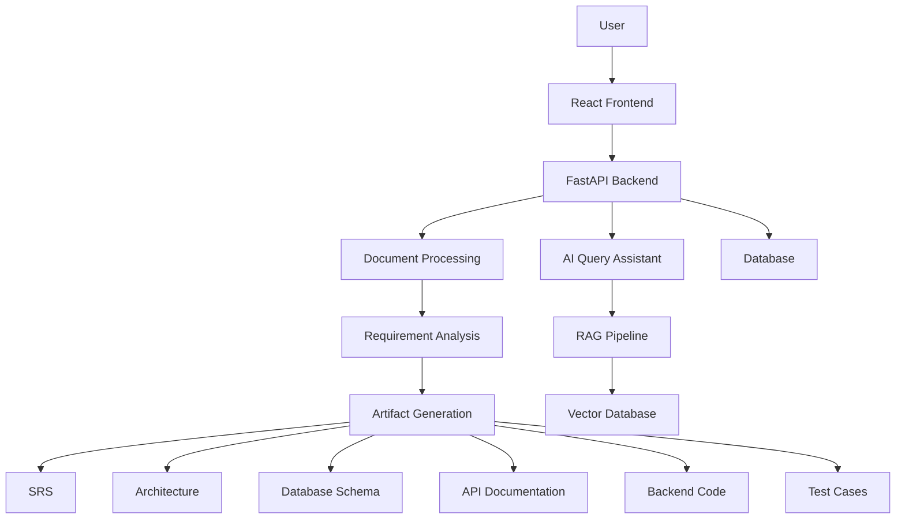

# AI Requirement-to-Code Assistant

An intelligent application that transforms software requirement documents into structured software engineering artifacts using Artificial Intelligence and Large Language Models.

## Overview

The AI Requirement-to-Code Assistant simplifies the software development process by analyzing uploaded requirement documents and generating essential development artifacts.

The system helps developers convert unstructured requirements into structured outputs such as Software Requirements Specifications, system architecture, database schemas, API documentation, backend code skeletons, test cases, and requirement traceability information.

It also provides an AI-powered assistant that enables users to interact with their project requirements and generated artifacts.

## Features

- **Requirement Document Analysis** – Upload and analyze PDF, DOCX, and TXT requirement documents.
- **Requirement Extraction** – Extract and organize functional and non-functional requirements.
- **SRS Generation** – Generate structured Software Requirements Specification documents.
- **Architecture Generation** – Generate system architecture descriptions and diagrams.
- **Database Schema Generation** – Identify entities, attributes, and relationships from requirements.
- **API Documentation** – Generate API specifications based on project requirements.
- **Backend Code Generation** – Generate initial backend code structures.
- **Test Case Generation** – Generate test cases from identified requirements.
- **Requirement Traceability** – Visualize relationships between requirements and generated artifacts.
- **AI Query Assistant** – Interact with project documents using an AI-powered assistant.

## System Architecture



## Technology Stack

### Frontend
- React
- Vite
- JavaScript
- Tailwind CSS
- React Router DOM
- React Flow

### Backend
- Python
- FastAPI
- SQLAlchemy
- Pydantic

### Database
- SQLite

### AI and Machine Learning
- Large Language Models (LLMs)
- Retrieval-Augmented Generation (RAG)
- ChromaDB

### Document Processing
- PDF
- DOCX
- TXT

### Tools
- Visual Studio Code
- Git
- GitHub

## Project Structure

```text
AI-Requirement-to-Code/
├── frontend/
│   ├── src/
│   ├── public/
│   ├── package.json
│   └── vite.config.js
│
├── backend/
│   ├── app/
│   ├── tests/
│   ├── storage/
│   ├── main.py
│   └── requirements.txt
│
├── README.md
└── ...
```

## Installation and Setup

### Prerequisites

- Python 3.11+
- Node.js
- npm
- Git

### Clone the Repository

```bash
git clone https://github.com/Dhanushree7/AI-Requirement-to-Code.git
cd AI-Requirement-to-Code
```

### Backend Setup

```bash
cd backend
python -m venv venv
```

Activate the virtual environment.

**Windows:**

```powershell
venv\Scripts\activate
```

Install dependencies:

```bash
pip install -r requirements.txt
```

Start the backend:

```bash
uvicorn main:app --reload
```

Backend URL:

```text
http://127.0.0.1:8000
```

API Documentation:

```text
http://127.0.0.1:8000/docs
```

### Frontend Setup

Open a new terminal:

```bash
cd frontend
npm install
npm run dev
```

The frontend will be available at the local development URL provided by Vite.

## AI Configuration

The application supports configurable AI providers based on the backend implementation.

API keys and provider settings should be configured using environment variables.

Example:

```env
AI_PROVIDER=gemini
GEMINI_API_KEY=your_api_key
```

## Testing

Run backend tests:

```bash
pytest
```

## Workflow

1. Create a project.
2. Upload software requirement documents.
3. Analyze the uploaded documents.
4. Extract and organize software requirements.
5. Generate software engineering artifacts.
6. Review the generated artifacts.
7. Interact with the AI assistant.
8. Explore requirement traceability relationships.

## Contributors

- **Dhanushree P**
- **Kanishka S**

## License

This project is developed for educational and software engineering purposes.
