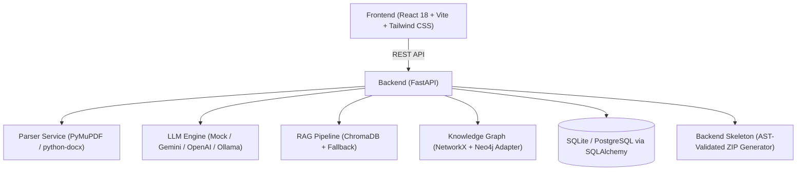

> **An Intelligent Framework for Automated Software Requirement Analysis and Code Generation using LLMs**

Req-to-Code is an end-to-end full-stack web application that ingests software requirement documents (PDF, DOCX, TXT) across **any domain** (Hospital, E-Commerce, Hotel, Banking, Education, Logistics, Food Delivery) and transforms them into structured engineering artifacts, including:
1. **SRS Document** (IEEE-830 compliant 8 sections, rendered markdown, exportable as Markdown and PDF)
2. **Architecture Specification** (Layered design suggestions with interactive Mermaid diagram and layer responsibilities)
3. **Database Schema** (Normalized relational entity-relationship modeling, table catalog, and SQL DDL export)
4. **API Documentation** (OpenAPI-compliant endpoints with query parameters, request/response bodies, HTTP badges; exportable as OpenAPI JSON, YAML, and Markdown)
5. **Backend Skeleton** (Working FastAPI project with models, schemas, routers, and AST-verified Python code; exportable as ZIP)
6. **Test Cases** (Functional, boundary, and negative test cases linked to requirement IDs; exportable as CSV and Excel)
7. **Traceability Knowledge Graph** (Interactive graph visualization of Requirements ➔ Modules ➔ APIs ➔ Database Entities ➔ Test Cases with blast-radius impact analysis)
8. **RAG-based AI Query Assistant** (Project-aware assistant with source citations powered by ChromaDB vector store; strictly grounded to active project context)

---

## Architecture Overview



---

## Tech Stack

- **Frontend:** React 18, Vite, Tailwind CSS, Lucide React, Mermaid.js, React Flow, React Markdown
- **Backend:** Python 3.11, FastAPI, Pydantic v2, SQLAlchemy, Uvicorn
- **Document Parsing:** PyMuPDF (`fitz`), `python-docx`
- **Vector Search / RAG:** ChromaDB, Sentence-Transformers
- **Knowledge Graph:** NetworkX (in-memory graph + JSON persistence) with automatic Neo4j bolt driver fallback
- **Testing:** Pytest (145 automated unit, integration, and multi-tenant security tests)

---

## Quick Start (Local Development)

### Prerequisites
- Python 3.11+
- Node.js 18+ and npm

### 1. Configure Environment
```bash
cp .env.example backend/.env
# Default configuration uses LLM_PROVIDER=mock (no API keys required!)
```

> [!WARNING]
> `.env` files contain sensitive local secrets and API keys. They are excluded by `.gitignore` and must **never** be committed or pushed to public version control.

### 2. Run the Backend
```bash
# Terminal 1 - Backend (from project root)
python run_backend.py
```
Backend will start on `http://127.0.0.1:8000` with Swagger docs available at `http://127.0.0.1:8000/docs`.

### 3. Run the Frontend
```bash
# Terminal 2 - Frontend
cd frontend
npm run dev
```
Frontend will be available at `http://localhost:5173`.

---

## Sample Documents Included

Pre-generated requirement specifications in `/sample_docs` (available in TXT, DOCX, and PDF):
1. **Library Management System** (`library_management_system.txt`, `.docx`, `.pdf`)
2. **Hospital Management System** (`hospital_management_system.txt`, `.docx`, `.pdf`)
3. **Online Shopping & E-Commerce Platform** (`online_shopping_system.txt`, `.docx`, `.pdf`)
4. **Hotel & Resort Booking System** (`hotel_booking_system.txt`, `.docx`, `.pdf`)

---

## LLM Provider Configuration

Req-to-Code supports four provider backends selectable via the `LLM_PROVIDER` environment variable:

| Provider | Setting | Requirements |
|---|---|---|
| **Mock (Default)** | `LLM_PROVIDER=mock` | Zero external dependencies or API keys. Uses document-driven heuristic extraction for any domain. |
| **Google Gemini** | `LLM_PROVIDER=gemini` | Set `GEMINI_API_KEY=your_key` and optional `GEMINI_MODEL=gemini-3.5-flash-lite` |
| **OpenAI** | `LLM_PROVIDER=openai` | Set `OPENAI_API_KEY=your_key` and optional `OPENAI_MODEL=gpt-4o` |
| **Ollama (Local)** | `LLM_PROVIDER=ollama` | Set `OLLAMA_BASE_URL=http://localhost:11434` and `OLLAMA_MODEL=llama3.1` |

In production environments (like Render), configure these keys directly in the cloud dashboard's **Environment Variables** section rather than using `.env` files.

---

## Running Automated Tests

Run the full pytest suite (145 unit, integration, multi-tenant security, and domain-independence tests):
```powershell
pytest tests -v
```

Tests cover:
- Parser service (PDF/DOCX/TXT extraction, text cleaning, chunking)
- Requirement extraction pipeline & CRUD
- Domain independence across Hospital, E-Commerce, Hotel, and Food Delivery
- Multi-tenant data isolation and security
- RAG assistant vector search, citations, and strict out-of-domain query refusal
- Dynamic suggested questions generation per project
- Artifact generation (SRS, Schema, Architecture, APIs, Code Skeleton, Test Cases)
- Auth and password reset workflows

---

## Render Cloud Deployment

Req-to-Code is production-ready for deployment on [Render](https://render.com).

### 1. Database (Render Managed PostgreSQL)
- Create a new **PostgreSQL** database on Render.
- Copy the **Internal Database URL** (`postgres://...`).

### 2. Backend (Render Web Service)
- **Environment:** Python 3
- **Build Command:** `pip install --upgrade pip && pip install -r backend/requirements.txt`
- **Start Command:** `uvicorn backend.app.main:app --host 0.0.0.0 --port $PORT`
- **Health Check Path:** `/health`
- **Key Environment Variables:**
  - `PYTHON_VERSION`: `3.11.9`
  - `ENVIRONMENT`: `production`
  - `DATABASE_URL`: Your Render PostgreSQL Internal Database URL
  - `JWT_SECRET_KEY`: A cryptographically random 64-character hex string (`openssl rand -hex 32`)
  - `CORS_ORIGINS`: `https://<your-frontend-static-site>.onrender.com`
  - `FRONTEND_URL`: `https://<your-frontend-static-site>.onrender.com`
  - `LLM_PROVIDER`: `gemini` (or `openai` / `mock`)
  - `GEMINI_API_KEY`: Your Google Gemini API Key
  - `ALLOW_DEV_EMAIL_LOG`: `False`
  - `STORAGE_DIR`: `/var/data` (Optional: set when attaching a Render Persistent Disk)

### 3. Frontend (Render Static Site)
- **Build Command:** `cd frontend && npm install && npm run build`
- **Publish Directory:** `frontend/dist`
- **Environment Variable:**
  - `VITE_API_URL`: `https://<your-backend-web-service>.onrender.com/api`
- **Redirects / Rewrites Rule (Mandatory for SPA Routing):**
  - **Type:** Rewrite
  - **Source:** `/*`
  - **Destination:** `/index.html`

---

## Docker Deployment

To spin up the full stack using Docker locally:
```bash
docker-compose up --build
```
- Frontend: `http://localhost:5173`
- Backend API: `http://localhost:8000`

---

## Key Features

- **Dashboard:** Live 5-step pipeline stepper (Upload ➔ Extraction ➔ RAG+LLM ➔ Generation ➔ Ready), 3x2 artifact card grid with live item counts, and single-click "Generate All" trigger.
- **Requirements:** Interactive tabular view with filters (FR, NFR, Actors, Entities, Modules, Constraints), inline add/edit modal, and ambiguity flagging with clarifying questions.
- **SRS Document:** Full IEEE-830 specification with markdown rendering, inline editing, and export as Markdown and PDF.
- **Architecture:** Layered design rendered with Mermaid.js, architecture rationale, and tech stack trade-offs with version history restore.
- **Database Schema:** Tables list with column data types, constraints, ER diagram view, SQL DDL export, and version history restore.
- **API Documentation:** Interactive Swagger-like documentation with colored HTTP badges and export as OpenAPI JSON, YAML, and Markdown.
- **Backend Code:** File tree explorer with syntax-highlighted code editor, AST syntax verification indicator, and 1-click ZIP download.
- **Test Cases:** Test scenario catalog with preconditions, steps, expected results, and export as CSV and Excel.
- **Knowledge Graph:** Interactive visual graph powered by React Flow with traceability matrix (Requirements ➔ Modules ➔ APIs ➔ Database ➔ Tests) and blast-radius impact analysis.
- **AI Query Assistant:** Slide-out drawer or full-page assistant that queries project context using ChromaDB with citations.
- **Theme:** Dark mode default with light mode toggle using CSS variables.

---

## License & Attribution
AI-generated artifacts are suggestions and should be reviewed and edited by the developer.  
Req-to-Code Framework © 2026.
